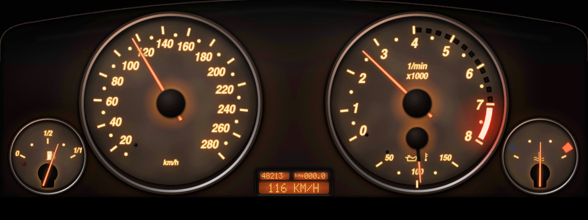
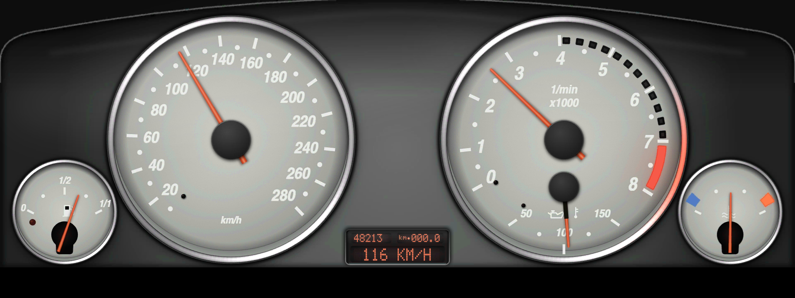
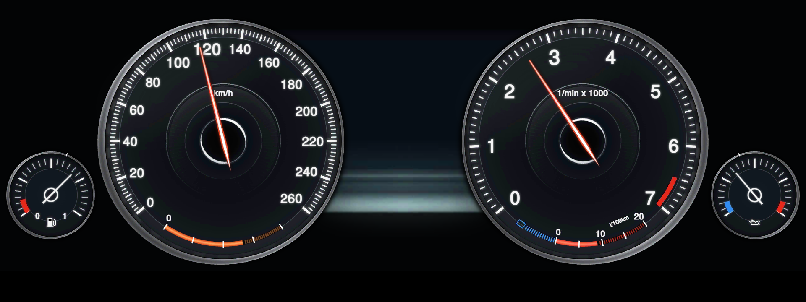
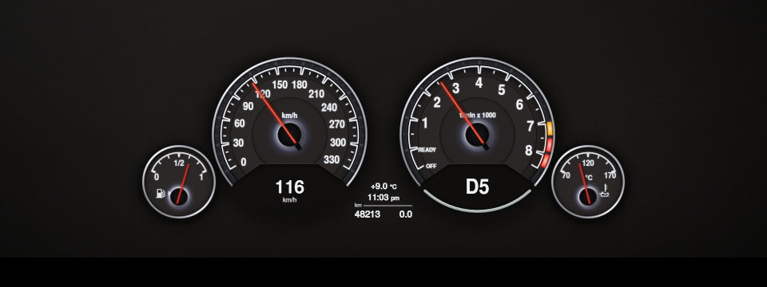
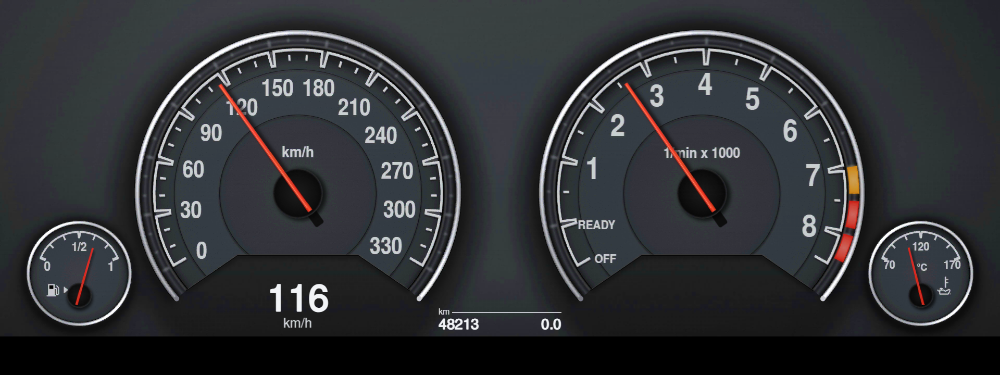

# 7amoody1985's MGU apps

A source for the [MGU Store](https://github.com/robertnisipeanu/mgu-store) on BMW iDrive 7 head units (MGU).
Unofficial: nothing here is made, endorsed or supported by BMW AG.

> [!WARNING]
> **Heritage Cluster is broken: don't install it for now.** It has been tested in a car (a G05 X5) and it doesn't
> render properly on the instrument cluster. It stays listed until a fixed version is out; if you have it installed,
> switch it off in its settings or uninstall it, and the stock cluster is back within seconds.

> [!NOTE]
> The apps here are built on a G05 X5 with iDrive 7. Try them parked first. They come as they are, without
> warranty or support.

## Add it to the Store

In the Store: **Settings → Add source**, type `7amoody1985/mgu-apps` and pick **Releases**. The Store reads
`catalog.json` from this repository's release tagged `catalog`.

## Apps

| App | Version | What it is |
|---|---|---|
| Heritage Cluster (broken, don't install) | 0.3.0 | **Broken: tested in a car, it doesn't render properly. Not advised to install for now.** Classic BMW instrument clusters on the car's 12.3-inch digital cluster, in place of the stock dials: the E-series analogue cluster (X5 E53, 5 Series E39) with its warning LEDs, LCDs and lamps, the F-series digital display (X5 F15, X6 F16, 5 Series F10, 7 Series F01) in Comfort and Sport, and the F-series M analogue cluster (M3 F80, M4 F82) by night or day. For any iDrive 7 car with the 12.3-inch cluster. Needs the cluster renderer (`cluster-render`) from the `robertnisipeanu/idrive-apps` source, which the Store installs with it. Screenshots below (as drawn on a PC, not what the car shows today). |

### Heritage Cluster

**Status: broken.** Tested in a G05 X5, and it doesn't render properly on the cluster, so installing it isn't advised until a fixed version is out. While it runs it replaces the picture on your instrument cluster, so try it parked first; switch it off in its settings, or uninstall it, and the stock cluster is back within seconds. BMW's own warning lights stay on top of it, but it isn't a certified instrument display.

Provided as is, without warranty; use it at your own risk. Not made, endorsed or supported by BMW AG.

#### Screenshots

How it is meant to look, rendered on a PC through the app's own engine at 116 km/h. In the car it doesn't render like this yet. The Store on the car shows no screenshots, so they are here. Pick the cluster, the look and the units in the app's settings.

| | |
|---|---|
| **E-series (X5 E53, 5 Series E39), night** | **E-series, day** |
|  |  |
| **F-series (X5 F15, X6, 5 and 7 Series), Comfort by day** | **F-series, Comfort at night** |
|  |  |
| **F-series, Sport** (follows the drive mode) | **F-series M (M3 F80, M4 F82), night** |
|  |  |
| **F-series M, day** |  |
|  |  |

**Which cars.** Any BMW with iDrive 7 and the 12.3-inch cluster (Live Cockpit Professional): every one gives apps the same 1920x720 cluster panel. The layout keeps clear of the G05's driver camera and glass corners, so it fits cars without them too. Units, rev counter (petrol or diesel) and tank size are settings; on M cars the F-series display follows M Drive's engine mode. Where there is no such panel, the app draws nothing and says why on its own screen.

### No longer here

The RideTube fork (`mdq_ridetube`, `mdq-ridetube-d`) and CarLink (`mdq_carlink`) were listed here until 2026-11-17.
They are personal experiments and are no longer offered in this source; installed copies keep working but get no
updates from it. They now live in [7amoody1985/mgu-apps-lab](https://github.com/7amoody1985/mgu-apps-lab), a test
source that isn't meant for general use. The RideTube fork's source stays at [7amoody1985/ridetube](https://github.com/7amoody1985/ridetube).

## Adding an app

The step-by-step checklist (also for coding agents) is [AGENTS.md](AGENTS.md); in short:

1. Put the built package in `packages/` as `<id>@<x.y.z>.tgz` (not committed: it goes into the release only).
   The package's `package.json` names the same id and version, and it holds no BMW SDK (`node_modules/oap-sdk`).
2. Add the app to `apps.json`: `id`, `kind` (`app` or `tool`), `title`, `description`, `version`, and as needed
   `requires` (`{"<id>": "<min version>"}`, also from other sources), `mguHmi` (`["ID7"]`), `uninstallable`,
   `icon` (a PNG in `icons/`, at most 128 KiB) and `"build": "unit"` for a source package the head unit builds.
   The id takes this source's prefix `mdq_` (`mdq_myapp`), never one BMW or another source uses.
3. Publish: `powershell -File tools\publish.ps1` (Python 3 and the GitHub CLI, signed in). It writes `dist/`
   (`catalog.json`, the packages, the icons) and uploads it to the `catalog` release.
4. Check it as the car sees it: `python -I tools/verify.py` (ends with `all ok`).
5. On the car: **Settings → Check now** in the Store.

The catalog format: [Publishing for the MGU Store](https://github.com/robertnisipeanu/mgu-store/blob/main/docs/PUBLISHING.md).
